# KuralGuard - Application Screenshots Showcase
*Curated & Captured according to the Google Stitch Civic Design System*

All 15 high-resolution (Retina 2x DPI) screenshots have been captured from the live application and cataloged below.

---

### 1. Hero Landing Page & Civic Safety Tagline
- **File**: `01_hero_landing_page.png`
- **Route**: `#/`
- **Description**: Features the official KuralGuard emblem, live status pulse, bilingual EN/Tamil switcher pill, the primary civic tagline *"Turn a local safety concern into the right next step."*, and high-emphasis action buttons ("Create a Safety Brief", "Try Interactive Demo").
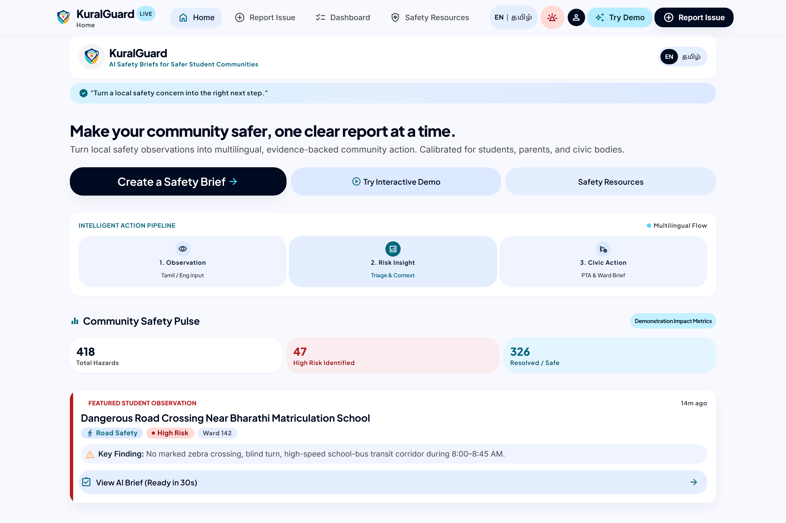

---

### 2. Demonstration Impact Metrics & Trust Architecture
- **File**: `02_community_safety_pulse_metrics.png`
- **Route**: `#/` (Pulse Section)
- **Description**: 3-column bento grid displaying real-time metrics: Total Hazards (12), High Risk Identified (4 in crimson), and Resolved / Safe (6 in deep teal).
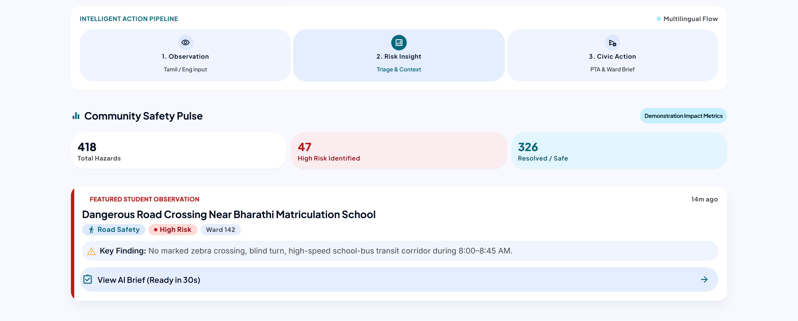

---

### 3. Three Core Civic Value Pillars
- **File**: `03_core_civic_value_pillars.png`
- **Route**: `#/` (How KuralGuard Protects)
- **Description**: Displays the three core value cards: (1) Understand Risk, (2) Get Safe Guidance, and (3) Support Community Action.
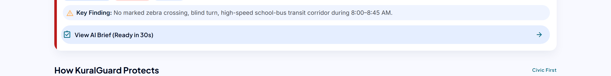

---

### 4. Featured Demo Scenario Callout
- **File**: `04_featured_demo_scenario_callout.png`
- **Route**: `#/` (Featured Student Observation)
- **Description**: High-elevation card with an intense red left hazard border, pulsing radar ping, hazard tags, and the one-click *"View AI Brief (Ready in 30s)"* demo trigger.
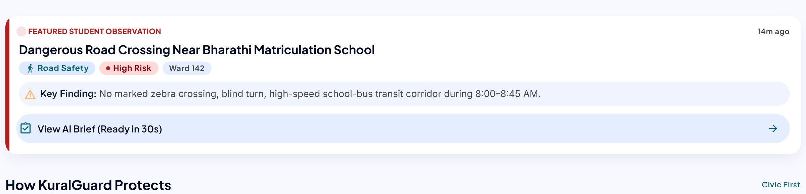

---

### 5. Report Issue: Step 1 Category Selection Grid
- **File**: `05_report_step1_category_selection.png`
- **Route**: `#/report` (Step 1 Describe)
- **Description**: 3-stage progress stepper and horizontal interactive category selection chips (Road Safety, Public Lighting, Flooding, Women's Safety, Health Concern, Sanitation).
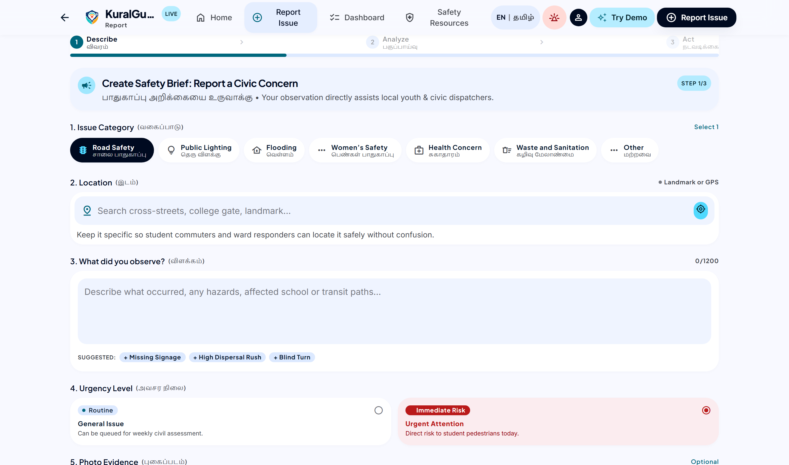

---

### 6. Report Issue: Precision GPS Auto-Detection & Geocoded Mini-Map
- **File**: `06_report_step1_gps_location_strip.png`
- **Route**: `#/report` (Location Section)
- **Description**: Shows the location input with GPS auto-detection active, verified geolocation status dot, and the inline geocoded satellite mini-map preview card.
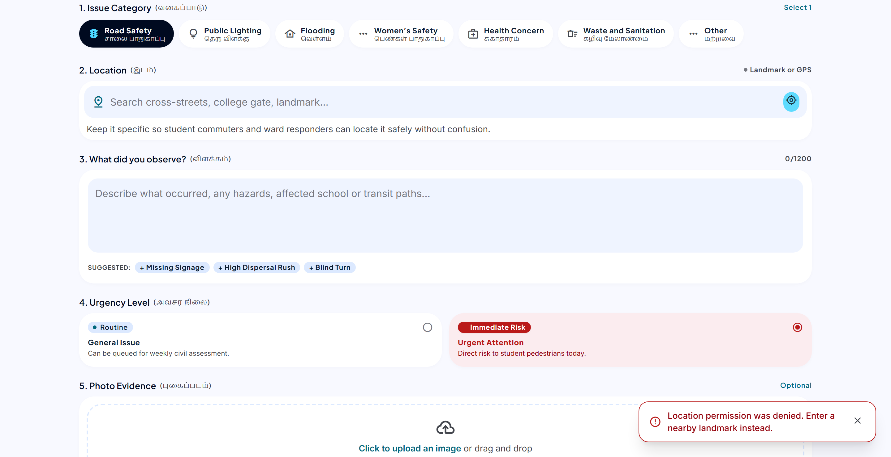

---

### 7. Report Issue: Incident Description, Quick-Tags & Photo Upload
- **File**: `07_report_step1_description_tags_upload.png`
- **Route**: `#/report` (Description & Evidence)
- **Description**: Expandable observation textarea with live character counter, one-tap quick observation tags (`+ Missing Signage`, `+ High Dispersal Rush`), urgency selector, and attached photo preview.
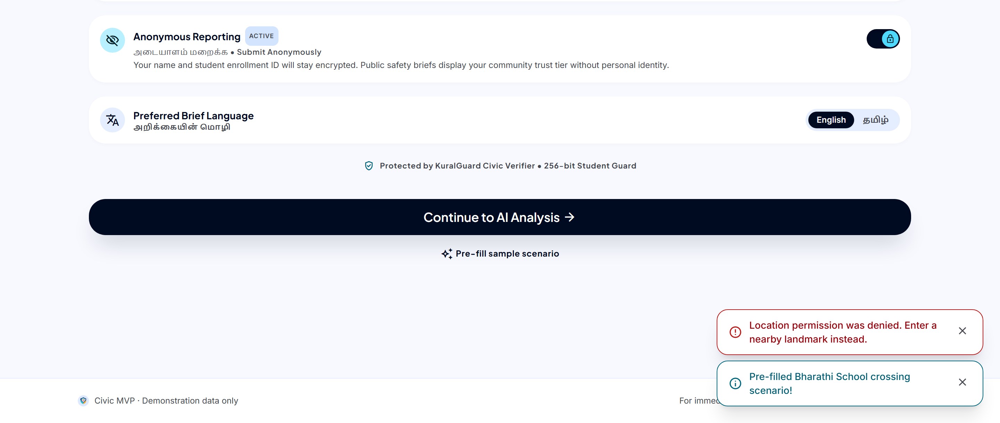

---

### 8. Report Issue: Accessible Anonymous Switch & Preferred Language Selector
- **File**: `08_report_step1_anonymous_and_language.png`
- **Route**: `#/report` (Privacy & Actions)
- **Description**: High-trust anonymous reporting switch with animated lock state, preferred brief language toggle (English / தமிழ்), civic trust verification seal, and "Continue to AI Analysis" CTA.
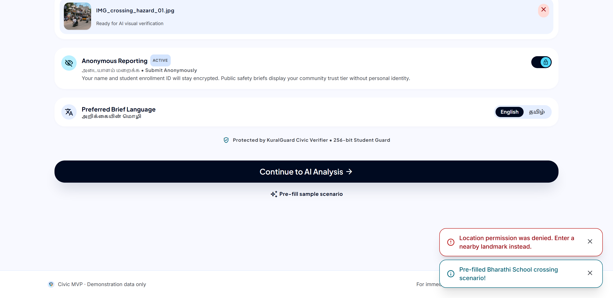

---

### 9. AI Safety Analysis: Real-Time Hazard Triage with 94% Confidence
- **File**: `09_ai_analysis_hazard_triage.png`
- **Route**: `#/analysis` (Step 2 Analyze)
- **Description**: AI model status badge, detected hazard card with pulsing HIGH RISK indicator, animated 94% confidence gauge, dual spatial vision lens (commute photo & geo-tag), and contributing risk factors.
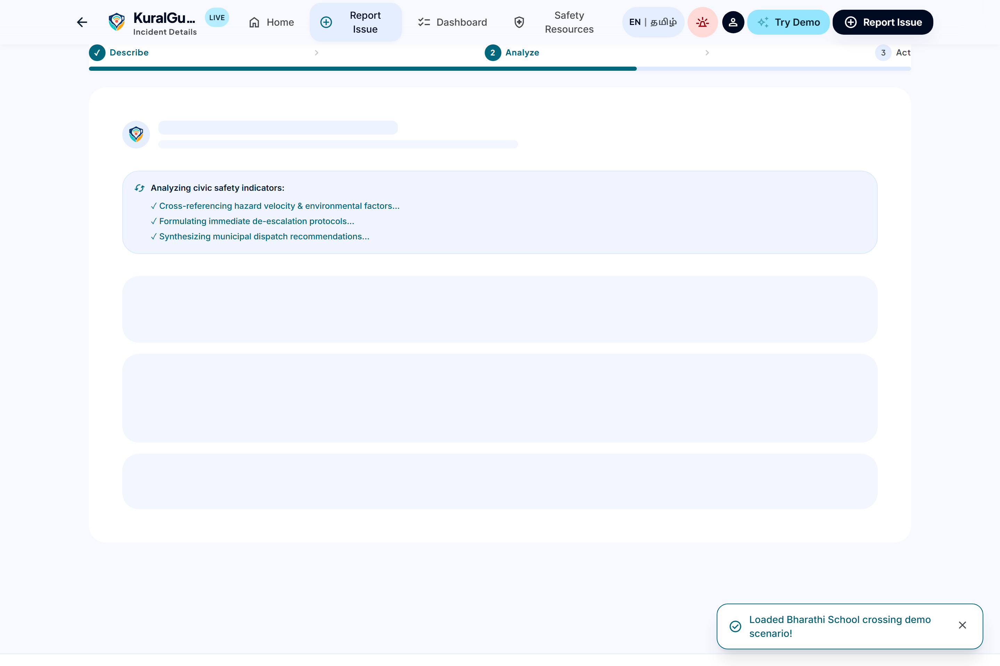

---

### 10. AI Safety Analysis: Immediate Safety Guidance & Emergency Dialers
- **File**: `10_ai_analysis_immediate_safety_advice.png`
- **Route**: `#/analysis` (Immediate Advice)
- **Description**: Deep navy high-visibility guidance card with safe navigation instructions, emergency dialing shortcuts (112/108), on-duty Ward Marshall intercom contact, and municipal engineering suggestions.
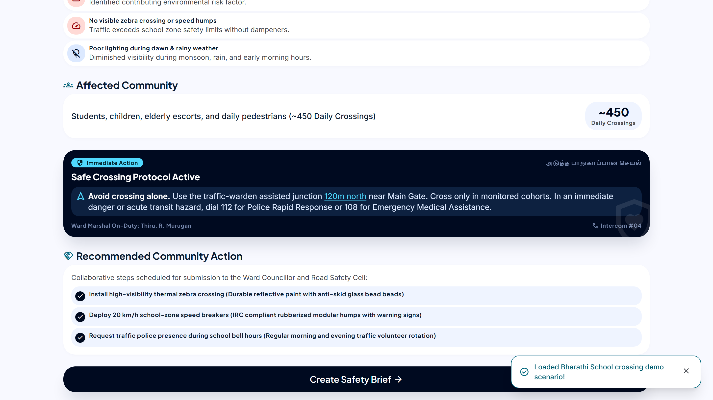

---

### 11. Generated Community Safety Brief: Official Civic Docket
- **File**: `11_generated_safety_brief_docket.png`
- **Route**: `#/generated-report` (Step 3 Act)
- **Description**: Official municipal civic docket (#KG-2025-0842) featuring official seals, tamper-evident security badge, demographic impact figures (450+ daily students), and cryptographic timestamp hash.
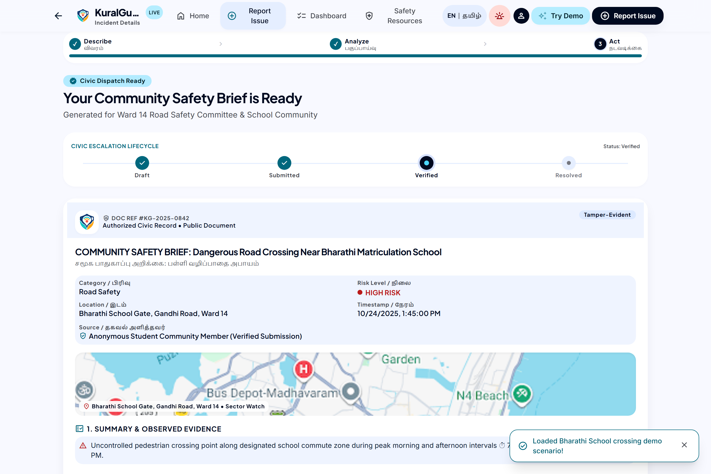

---

### 12. Civic Lifecycle Timeline & Export Utilities
- **File**: `12_civic_lifecycle_timeline_and_actions.png`
- **Route**: `#/generated-report` (Civic Actions)
- **Description**: 4-stage civic lifecycle tracker (Draft → Submitted → Verified → Resolved) and 4 distribution action buttons (Copy Brief Text, Download PDF/TXT, Share via App, Print).
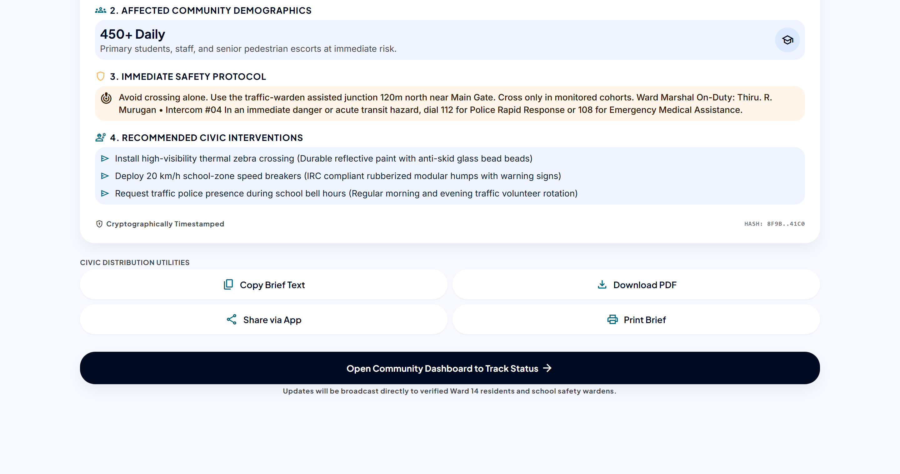

---

### 13. Community Priority Dashboard: Live KPI Overview & Search Filters
- **File**: `13_community_dashboard_kpis_and_search.png`
- **Route**: `#/dashboard` (Header & KPIs)
- **Description**: Live SafeZones watch header, 4-card metric bento grid (Total Reports, High-Risk Issues, Resolved Reports, Category Breakdown), keyword search, and multi-facet category filters.
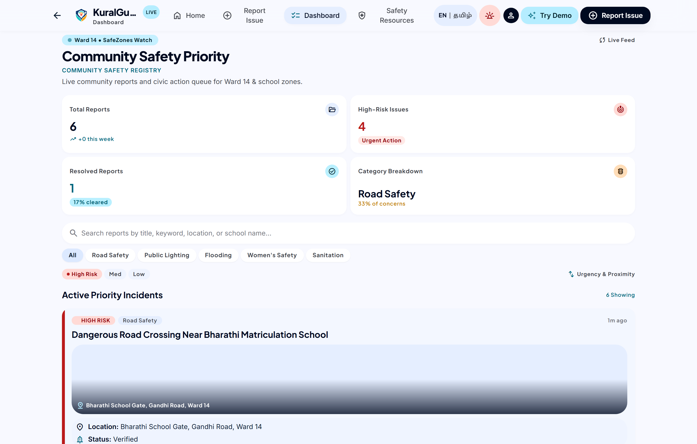

---

### 14. Community Dashboard: Ward 14 Patrol & Hazard Radar Map
- **File**: `14_community_dashboard_radar_map_and_feed.png`
- **Route**: `#/dashboard` (Radar Map & Incidents Feed)
- **Description**: Live cluster radar map card with pulsing school hotspot, priority incident cards with severity borders, "View Brief" and "Mark Resolved" demo actions, and "Spot a new hazard?" callout.
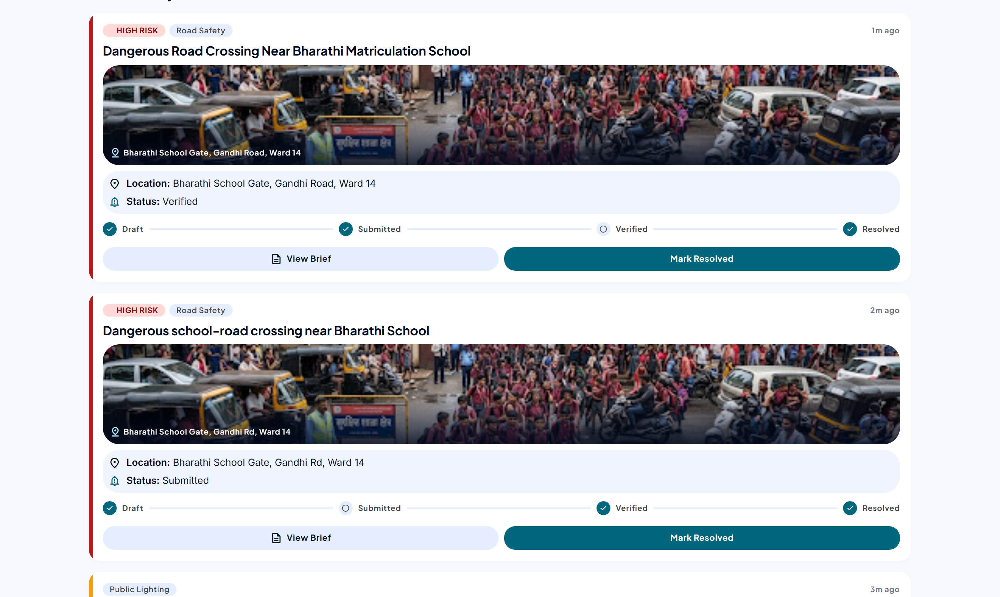

---

### 15. Safety & Emergency Resources Directory
- **File**: `15_safety_and_emergency_resources.png`
- **Route**: `#/resources`
- **Description**: Safety directory with mandatory demo disclosure notice, fast-tap speed dial pills (112, 181, 108, 1098), Women's Pink Patrol contacts, and Ward Councillor desk details.
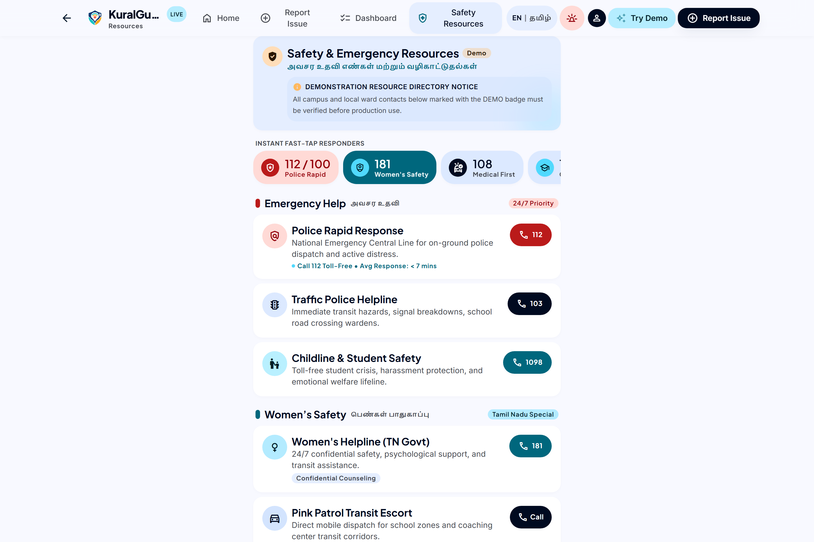
